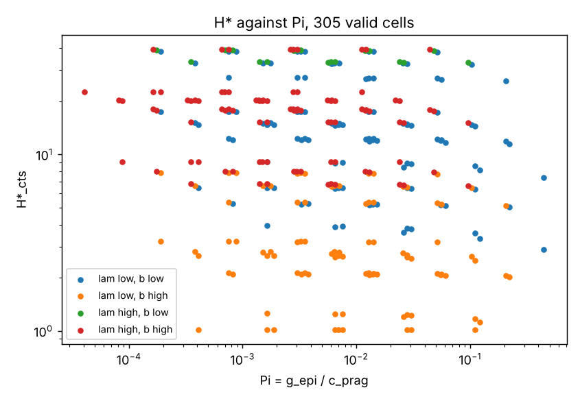

# Findings: does H\* collapse onto a dimensionless group?

<!-- cspell:words prag parameterisation PREREG -->

**Date:** 2026-10-26
**Issue:** #58
**Registration:** `PREREG.md`, committed and pushed alone ahead of `sweep.py` and any computed crossover horizon.

## Verdict

**Collapse onto `Pi` is not accepted.** All three registered criteria `FIRED` against it, and `Pi` explains less of `ln H*_cts` (`R^2 = 0.054`) than `lam` alone does (`0.351`). The registered alternatives ran, and **none of them is accepted either**. `kappa` alone fits well (`R^2 = 0.935`, criteria 1 and 2 pass) but fails the agreement criterion: cells that share `kappa` disagree in `H*_cts` by up to a factor of 3.1.

On this family, then, the measured `H*` is a fact about the parameterisation, not a structural threshold set by one group.

A post hoc diagnostic (below, not registered) found something that matters more than the verdict. In this family the crossover is carried entirely by the ambiguity term `1/2 tr(Lambda S)`, not by epistemic value. Removing the epistemic term moves no crossover by more than 35%, and the median shift is 0.3%. Removing the ambiguity term removes every crossover. The `H*` measured here is therefore not the "epistemic value outweighs the pragmatic gradient" threshold the question was posed about.

## The two-policy caveat, in full

`H*` here is the horizon at which a constant `+u_max` walk (`pi_epi`, the `T = 1` epistemic maximiser) beats a constant `-u_max` walk (`pi_prag`, the `T = 1` goal-mismatch minimiser) under the full EFE. This is a comparison between two fixed policies, not policy optimisation. Its crossover bounds the crossover of the optimal agent from above. It is not that crossover. An optimal policy can mix directions, stop, or turn round, and its own `H*` may follow different structure from anything reported here. Nothing below is a claim about the optimal agent.

## Cell categories

| Category | Cells |
| --- | --- |
| `valid` | 305 |
| `no_cross` | 108 |
| `cross_at_1` | 19 |
| `multi_cross`, `degenerate`, `nonfinite` | 0 |

That makes 305 of 432 cells valid, the same count the scoping run recorded. Every `no_cross` cell has `kappa <= 0.186`, which is the low corner of the `(lam, b)` plane. Every `cross_at_1` cell has `kappa >= 1.86`, almost all of them `kappa = 4`. The valid set therefore under-covers both ends of `kappa`, and its `H*` values are censored above at 40 and below at 1. `H*_cts` runs from 1.01 to 39.4 with a median of 11.4. At the top value, `kappa = 4`, only 9 cells are valid, all at `H*_cts = 1.01`.

The `T = 1` policy check passed in all 432 cells: `pi_prag` sits on `-u_max` and `pi_epi` on `+u_max`. As an independent check, the prefix-sum margin agreed with per-`T` `policy_efe` calls to `rtol = 1e-12` on spot cells at `T = 1, 7, 23, 40`.

## The registered test of `Pi`

`R^2` of `ln H*_cts` on `ln p` for each single raw parameter:

| `lam` | `b` | `sigma_g` | `d` | `Sigma_0^-` | `q` |
| --- | --- | --- | --- | --- | --- |
| 0.351 | 0.171 | 0.000 | 0.001 | 0.000 | 0.000 |

| Criterion | Outcome | Detail |
| --- | --- | --- |
| 1. `R^2` on `ln Pi` > 0.90 | `FIRED` | `R^2 = 0.054` |
| 2. Beats every raw parameter by 0.15 | `FIRED` | below `lam` (0.351) and `b` (0.171) |
| 3. Cross-quadrant cells overlapping in `Pi` agree within 15% | `FIRED` | 37 of 718 overlapping pairs agree; worst ratio 33.0 |

The registration expected this. Leading order predicts no crossing above `T = 1` when `Pi < 1`, and every valid cell has `Pi < 0.5`. Every crossing seen therefore lives in sub-leading structure that `Pi` does not see. Criterion 3 shows it most clearly. `Pi` does not depend on `b`, but `H*` moves strongly with `b` at fixed `Pi`. That is the sharp test the registration named.

## The registered alternatives

Each of these ran because `Pi` was not accepted. Every group tried is listed.

| Group | `R^2` | c1 | c2 | c3 (agreeing / overlapping pairs, worst ratio) | Accepted |
| --- | --- | --- | --- | --- | --- |
| `Pi` | 0.054 | FIRED | FIRED | FIRED (37 / 718, 33.0) | no |
| `kappa` | 0.935 | NOT TRIGGERED | NOT TRIGGERED | FIRED (1215 / 5994, 3.13) | no |
| `Pi_inf` | 0.090 | FIRED | FIRED | FIRED (0 / 930, 18.1) | no |
| `s` | 0.000 | FIRED | NOT APPLICABLE | FIRED (500 / 10836, 39.0) | no |
| `N_sat` | 0.522 | FIRED | NOT TRIGGERED | FIRED (404 / 1998, 3.13) | no |
| `Pi_amb` | 0.237 | FIRED | FIRED | FIRED (0 / 1926, 14.6) | no |

The table reads in ADR-029 terms. `NOT TRIGGERED` means the criterion held. `FIRED` means it failed. For `s`, criterion 2 is `NOT APPLICABLE` by construction, because `s = Sigma_0^-` in this grid.

Two-group fit (registered as alternative 6, and not a collapse): `ln H*_cts ~ beta ln Pi + gamma ln kappa` gives `R^2 = 0.949`, `beta = -0.065`, `gamma = -1.166`. Almost all of the fit comes from `kappa`, and adding `Pi` raises `R^2` by 0.014.

`kappa` is the dominant axis. `H*` falls roughly as `kappa^-1.2`. It is not a collapse, though. At fixed `kappa`, `H*_cts` still spans a factor of about 3 (7.4 to 22.5 at `kappa = 0.4`), and the spread is systematic, not noise. `H*` rises with both `lam` and `d`, while `sigma_g` and `Sigma_0^-` barely move it.



## Post hoc: which term carries the crossover

The following was not registered. It is a diagnostic of mechanism, run after the registered analysis. It tests no group and changes no outcome above. `ablation.py` recomputes the margin in every valid cell with one term removed from both policies' per-step `G`, and re-reads the crossover with the registered rule.

| Removed from `G` | Cells still `valid` | Shift in `ln H*` |
| --- | --- | --- |
| epistemic term | 305 of 305 | median 0.0027, max 0.296; 95.7% within 5% |
| ambiguity term `1/2 tr(Lambda S)` | 0 of 305 (all `no_cross`) | n/a |

So in this family `H*` is the horizon at which the pragmatic policy's own ambiguity cost catches up with its goal advantage. It walks into the blind region, where `R` grows as `r0 * exp(k * kappa)`. That explains three things above:

- `kappa` dominates, because it sets the exponential rate.
- `sigma_g` drops out, because the mean term and the ambiguity term both scale with `Lambda = 1/sigma_g^2`, while the epistemic term, which would not, contributes nothing.
- With ambiguity removed, the margin follows the leading-order account, and with `Pi < 1` nothing crosses.

This answers the question the issue opened with more sharply than the collapse test does. Under the full EFE, with these two policies, epistemic value does not drive the crossover anywhere on this grid.

### A post hoc candidate, named and not tested

Drop the epistemic term and the covariance part of `S`, and the margin is approximately

```text
Delta(T) / Lambda  ~  T(T+1) * b * d  -  r0 * sum_{k=1..T} sinh(k * kappa)
```

Since `b*d/r0 = kappa / (2 * Pi_amb)`, the crossing solves `sum_{k<=T} sinh(k*kappa) = T(T+1) * kappa / (2 * Pi_amb)`. That makes `H*` a function of the pair `(kappa, Pi_amb)`. Each group was registered alone, but the pairing was not. It is consistent with what is seen at fixed `kappa`: `H*` rises with `lam` and `d` and ignores `sigma_g` and `Sigma_0^-`. Under the registration's own rule it is **not tested on this grid**. Testing it needs a fresh registration and a fresh grid.

## Deviations from the registration

- **None in the registered analysis.** The grid, policies, margin, categories, thresholds and alternatives ran as written.
- **The issue said "octants".** `PREREG.md` already read that as the four quadrants of a median split on `lam` and `b`, before the data, so this is not a deviation. It is repeated here so the reading is visible next to the result.
- **`ablation.py` is post hoc** and is reported as such above.

## What would move this forward

1. Register and run the `(kappa, Pi_amb)` pair on a fresh grid, varying `r0` and `x_s` so that `s` separates from `Sigma_0^-`. As registered, it is a two-group fit, not a collapse. A single group would follow only if the sinh relation can be reduced.
2. If the target is an *epistemic* crossover, the two-policy measure on this family cannot see one. That needs a family with `Pi > 1` somewhere, or a mean-only pragmatic in the scoring, which removes the ambiguity channel by construction. Either change needs its own registration.
3. The optimal-agent crossover, through the enumerated search (ADR-031/ADR-033), remains the object the two-policy bound stands in for.

## Reproduce

```bash
uv run --extra examples python experiments/collapse/sweep.py     # results.csv, collapse.png, the report
uv run --extra examples python experiments/collapse/ablation.py  # the post hoc term ablation
```

The sweep takes about 20 s on a CPU.
